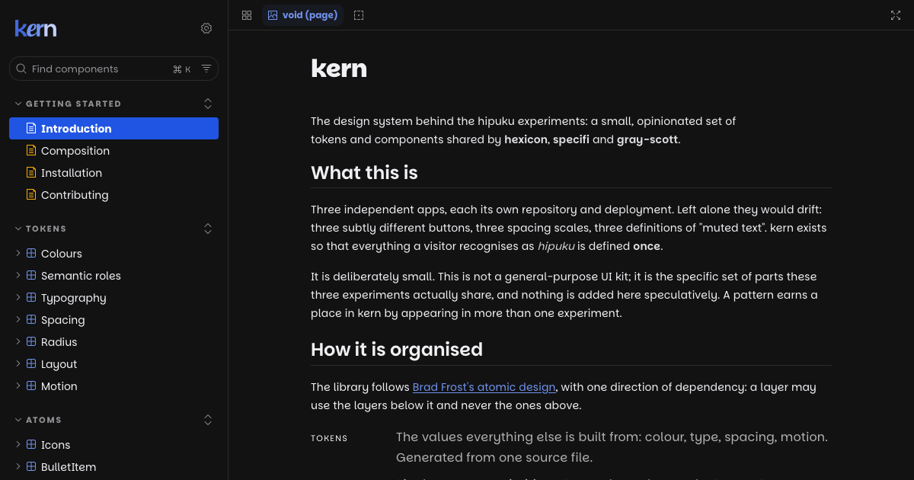

# kern

The shared component library and design tokens behind four browser tools (hexicon, specifi,
gray-scott and tokenise), consumed as TypeScript source with no build step. React 19 and Tailwind
CSS v4.



[](https://kern.hipuku.dev)

## At a glance

- **38 components in four layers**, one direction of dependency, held by lint.
  [DESIGN § Atomic tiers](DESIGN.md#atomic-tiers)
- **One token source.** Every value is declared once; the CSS and the Storybook token pages come
  from it. [DESIGN § One source](DESIGN.md#one-source)
- **Source only.** No build and no publish; each tool pins a git tag.
  [DESIGN § Source only, no build](DESIGN.md#source-only-no-build)
- **A public API.** The barrels are the surface, and deep imports fail.
  [DESIGN § A public API](DESIGN.md#a-public-api)
- **Contrast enforced.** Each ink role names the surfaces it may sit on, and a test holds those
  pairings to WCAG AA. [DESIGN § Accessibility](DESIGN.md#accessibility)
- **Pinned consumers.** All four tools are on v1.5.0. [DESIGN § Versioning](DESIGN.md#versioning)

## Documentation

| File                                 | Covers                                                                    |
| ------------------------------------ | ------------------------------------------------------------------------- |
| [Storybook](https://kern.hipuku.dev) | Guides, the living token reference, and every component with its controls |
| [`DESIGN.md`](./DESIGN.md)           | Distribution, components, tokens, accessibility and versioning            |
| [`WORKFLOW.md`](./WORKFLOW.md)       | Branches, pull requests, the checks that gate them, and releases          |
| [`CHANGELOG.md`](./CHANGELOG.md)     | What each tag changed                                                     |

## Relationship to haus

kern and [haus](https://github.com/hipuku/haus) are separate design systems. haus publishes W3C
DTCG tokens and React components to npm, for consumers it does not know. kern knows each of its
consumers by name and each pins a tag, which is what let v1 be a breaking rebuild adopted one tool at
a time.

## Install

Pin a tag in the tool's `package.json`:

```jsonc
"dependencies": { "kern": "github:hipuku/kern#v1.5.0" }
```

Import from the package, or from a layer barrel:

```ts
import { AppShell, ParamSlider, ToggleChip } from "kern";
import { palette, type AccentName } from "kern/tokens";
```

Tailwind v4 scans only within the project root, so the tool's `src/index.css` imports kern's
stylesheet and registers its source. The `@source` path is relative to that stylesheet; from a file
elsewhere, adjust it. Without the line the classes are absent and components render unstyled with no
error:

```css
@import "tailwindcss";
@import "kern/kern.css";
@source "../node_modules/kern/src";
```

## Develop

Node 22.12 or later (`.nvmrc`).

```bash
npm install
```

```bash
npm run storybook
```

To see kern edits live inside a tool, link it (the git install is a copy). Run the first command in
kern's root. The link does not survive `npm install`, so re-run the second after a reinstall:

```bash
npm link
```

```bash
cd ../your-tool && npm link kern
```

A linked kern resolves React from its own `node_modules`, so two copies can load and hooks fail with
an invalid hook call. Add `resolve: { dedupe: ["react", "react-dom"] }` to the tool's Vite config
while linked.

## Scripts

| Script                    | What it does                                                       |
| ------------------------- | ------------------------------------------------------------------ |
| `npm run storybook`       | Storybook on localhost:6006                                        |
| `npm run tokens`          | Regenerate the token CSS from `src/tokens/tokens.ts`               |
| `npm run tokens:check`    | Fail if the committed token CSS is stale                           |
| `npm run lint`            | ESLint                                                             |
| `npm run lint:prose`      | Fail if a tracked file has more em dashes than its baseline        |
| `npm run format`          | Prettier, writing                                                  |
| `npm run format:check`    | Prettier, checking only                                            |
| `npm run typecheck`       | `tsc --noEmit`                                                     |
| `npm test`                | Vitest, with axe on every component                                |
| `npm run build-storybook` | Production Storybook build                                         |
| `npm run check:links`     | Every story link in the docs resolves; run `build-storybook` first |

## Stack

React 19 · TypeScript · Tailwind CSS v4 · class-variance-authority · lucide-react · Storybook 10 ·
Vitest · Testing Library · vitest-axe
